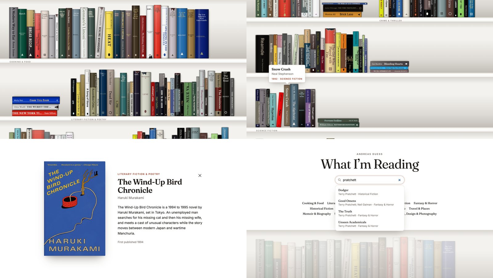
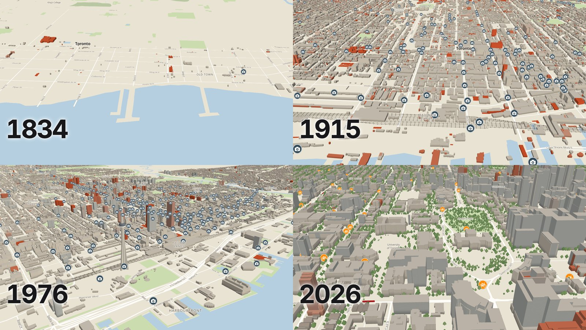

# Andreas Duess

I run [Duess Strategies](https://duess.com), where I help my clients put AI to work, and I am CEO and co-founder of [FishDog](https://fish.dog), a synthetic population platform. Before that: ten years in London advertising, including the European launches of Google Ads and Autonomy, then sixteen years building Nourish, a marketing agency in Toronto, sold in 2023. I teach AI strategy at Ivey Business School and write the Future Bites column for Food in Canada.

Most of what is here I built with Claude Code.

**Building**

[What I'm Reading](https://whatiamreading.com): the books on my shelves at home, drawn as a bookshelf. Every spine is generated in code from the book's real format, page count and cover colours, with wear, torn jackets and the odd book leaning into a gap. Click one and it comes off the shelf, turns to its cover and opens a short note. Search the shelves or recommend a book. Plain JavaScript and CSS 3D on a Cloudflare Worker. [Code](https://github.com/andreas-duess/duess-library).

[Toronto Through Time](https://torontothroughtime.com): a 3D map of the old City of Toronto with a year slider from 1793 to today. Each building appears in the year it was built, the shoreline moves, the railways arrive, and buildings that are gone come back from the fire insurance plans. Built on City of Toronto Open Data with deck.gl and MapLibre, and a Python pipeline that dates 105,000 buildings. [Code](https://github.com/andreas-duess/toronto-through-time).

[unshittify.dev](https://unshittify.dev): a public log of people taking back hardware they own from cloud lock-in, subscriptions and dead apps: TVs, printers, appliances, headphones. Each entry links the code or write-up and says whether AI helped build it. [Code](https://github.com/andreas-duess/unshittify) and [data](https://github.com/andreas-duess/unshittify-data) (CC BY 4.0).

[Tickbar](https://github.com/andreas-duess/tickbar): a to-do list in the Mac menu bar that reads and writes a plain Markdown file. Shows today's meetings, overdue tasks and what is due next. Built for Obsidian, works with any Markdown file. One Swift file.

**Elsewhere**

[duess.com](https://duess.com) · [LinkedIn](https://www.linkedin.com/in/andreasduess/) · [X](https://x.com/AndreasDuess)
